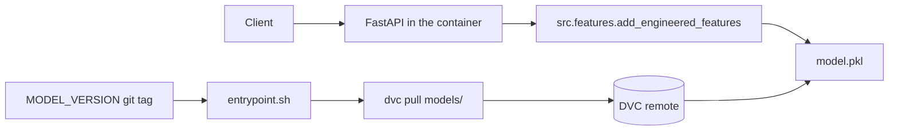
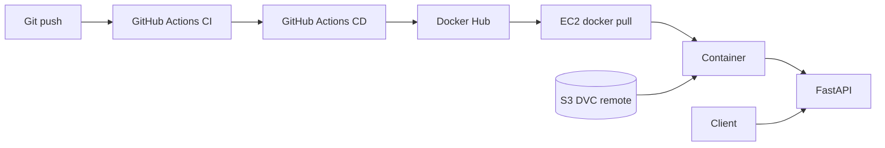

# PriceOptima

[](https://github.com/shreyanshhhhhhhh/MLOps_FinaL/actions/workflows/ci.yml)
[](https://github.com/shreyanshhhhhhhh/MLOps_FinaL/actions/workflows/cd.yml)

PriceOptima predicts monthly quantity sold (`qty`) from price and context, then recommends a revenue-maximising price by scoring that model across a price grid.

Phase 1 is the training system: one parameter file, a DVC pipeline, and an MLflow sweep that promotes a single artifact. Phase 2 is the serving system: a FastAPI process in a container that pulls `models/model.pkl` from the DVC remote at start. The image does not contain the pickle. Phase 3 is the release path: GitHub Actions builds that image, a registry stores it, and an EC2 host runs it.

The dataset is the Kaggle [Retail Price Optimization](https://www.kaggle.com/datasets/suddharshan/retail-price-optimization) file `retail_price.csv`: 676 product-months, 30 columns, January 2017 through August 2018. The CSV is not in Git. `data/raw/retail_price.csv.dvc` is the pointer.

The laboratory write-up is `docs/PROJECT_REPORT.md`. The printable copy is `docs/PriceOptima_Report.pdf`. The slide deck is `docs/PriceOptima_Presentation.pptx`. The code pack for submission is `PriceOptima_submission.zip` in the repository root.

## Layout

```
data/raw/                retail_price.csv, tracked by DVC
data/processed/          train/test splits and engineered frames
src/                     config, preprocess, features, train, evaluate, select_best
app/                     FastAPI service (health, ready, predict, optimize, metrics)
models/                  preprocessor.joblib, model.pkl, model_meta.json
metrics/                 train_runs.json, metrics.json, diagnostic plots
notebooks/eda.ipynb      EDA only, not part of the pipeline
tests/                   schema, leakage, feature fixture, API
scripts/                 entrypoint, model fetch, smoke test, deploy, bootstrap
.github/workflows/       CI, CD, and the manual model release
docs/REGISTRY.md         how a model version is named, promoted, and rolled back
docs/EC2_SETUP.md        instance, IAM, security group, swap, reboot test
docs/RUNBOOK.md          deploy, roll back, logs, secret rotation
docs/SECRETS.md          every GitHub secret and where it is used
params.yaml              split, seed, features, hyperparameter grid
dvc.yaml                 preprocess -> features -> train -> evaluate -> select_best
Dockerfile               multi-stage image, no model binary
dvc-storage/             committed local DVC remote (no cloud account)
docker-compose.yml       local run against the DVC remote
```

`src/scoring.py` is the only definition of RMSE, MAE, and R². `src/provenance.py` reads the git commit and the raw-data DVC hash so train and select_best stamp the same identity.

## Commands from a clean clone

```bash
make setup
source .venv/bin/activate
dvc pull
dvc repro
make exp
dvc push
```

`make setup` creates `.venv` and installs `requirements.txt`. Activate it before the raw `dvc` commands so they use that environment. `make exp`, `make test`, and `make lint` call `.venv/bin` themselves.

| Target | What it does |
| --- | --- |
| `make setup` | Create the venv and install pinned dependencies |
| `make repro` | `dvc repro`. The second run skips stages whose deps and params did not change |
| `make exp` | Force `train`, `evaluate`, and `select_best`, so the sweep always logs new MLflow runs |
| `make test` | `pytest` |
| `make lint` | `ruff check src app tests` |
| `make pipeline-check` | `dvc status` and `dvc repro --dry` against the committed lock |
| `make dag` | `dvc dag` |
| `make push` | `dvc push` to the default remote |

Inspect the sweep. MLflow 3.17 keeps the directory store behind an opt-in, and the UI opens on the Traces tab:

```bash
export MLFLOW_ALLOW_FILE_STORE=true
mlflow ui --backend-store-uri ./mlruns
```

Open experiment `priceoptima-demand`, switch the top toggle to **Model training**, then **Training runs**. Sort by `test_rmse`. The metric is logged on every run; the default column set is created-time, so add `test_rmse` from the Columns menu if it is not already on screen.

Open the `priceoptima-demand` experiment and sort by `test_rmse`. The grid in `params.yaml` is 14 runs (linear regression, ridge, random forest, gradient boosting, lightgbm). `make exp` appends another 14 because MLflow keeps history.

`dvc pull` on a fresh clone reads `dvc-storage/` inside this repository. That directory is the local remote, committed so CI can check the lock without an AWS account. If those files are missing, put the Kaggle CSV at `data/raw/retail_price.csv`. The md5 in `data/raw/retail_price.csv.dvc` must match. A public copy of the same file is `https://raw.githubusercontent.com/suddhasheel333/retail-price-optimization/main/data/retail_price.csv`.

## DVC remote

`.dvc/config` declares two remotes:

- `local` (default), the directory `dvc-storage` inside the clone. DVC stores paths relative to `.dvc/config`, so the file contains `../dvc-storage`. `dvc push` updates that directory. Commit the new files. CI uses this remote when `AWS_ROLE_ARN` and `AWS_ACCESS_KEY_ID` are both unset, and uses `s3` when either secret is set.
- `s3`, URL `s3://priceoptima-sagar-2026/priceoptima` in `eu-north-1`. CI uses it only when an AWS secret is set.

Credentials never go in `.dvc/config`. Use environment variables or `dvc remote modify --local`, which writes `.dvc/config.local` (gitignored). Switching to S3 or Google Drive is written out in `docs/REGISTRY.md`.

## Decisions worth defending

- The split is the last 20% of distinct months (May–August 2018 on this file), not a random row split. A pricing model is used on future months, and a random split puts those months into training. The seed does not shuffle the cut. It only seeds estimators that use randomness. `n_jobs` is fixed at 1 for the same reason.
- `01-05-2017` is parsed with `%d-%m-%Y`. Every raw date is the first of a month, so month-first parsing would still sort, but it would label May as 5 January.
- Outlier fences are Tukey IQRs fit on the training months only, then applied to both splits. Rows are clipped, not dropped, so the product-month panel stays complete. Thresholds live in `data/processed/preprocess_meta.json`.
- `total_price` is revenue and tracks `qty` (correlation about 0.75). `customers` is the buyer count from the same product-month. Both stay in the processed CSV for audit and are listed under `excluded_from_model`. `log_qty` is written for Phase 2 elasticity work and is also excluded, because it is a transform of the target.
- `product_id` is not one-hot encoded. There are 52 ids in 676 rows. Category (9 levels) is the grouping the linear model can estimate. `s` is constant inside each product and calendar month and repeats a year later, so it behaves as a seasonal index rather than a copy of `qty`. It stays in the model. `volume` is constant per product.
- The price ratio is `unit_price / mean(comp_1, comp_2, comp_3)`. The individual competitor prices stay too. Phase 1 is ranking predictive models, not reading coefficients, so the correlation between price, log price, and the ratio is acceptable. A non-positive denominator becomes missing and is median-imputed from train.
- The preprocessor (median impute, standard scale, one-hot with `handle_unknown="ignore"`) is fit inside the features stage on train only and saved as `models/preprocessor.joblib`. Train and evaluate only call `transform`. One matrix is shared by linear and tree models. Trees are invariant to a monotonic scaling, so the scaler does not change their splits in a way that matters here, and the linear models need it.
- Metrics are always on the clipped `qty` the model was trained to predict, not on `log_qty`. RMSE is the selection metric. MAE and R² are logged beside it.
- `make repro` is allowed to skip. `make exp` forces the three modelling stages so a warm cache cannot hide an empty MLflow store. `./mlruns` is gitignored and is not a DVC output. The registry artifact is the pickle DVC pushes. MLflow 3.17 treats that directory store as maintenance-only, so the process sets `MLFLOW_ALLOW_FILE_STORE=true` rather than switching the lab to a database. The same release saves sklearn models with skops and rejects tree and LightGBM types unless the caller names them. `SKOPS_TRUSTED_TYPES` is that allow-list, limited to estimators this process just fit.
- `select_best` asks MLflow for finished runs and sorts by `test_rmse`. Ties keep the later run. It does not trust a hand-picked filename. Evaluate writes the same ranking for the current sweep to `metrics/metrics.json` and the plots. If the two disagree, the MLflow run is the one that is promoted, and the metadata records both ids.
- LightGBM runs with `num_leaves` 31 and 63 land on the same test RMSE. The training panel is 516 rows and LightGBM's default `min_child_samples` is 20, so the trees stop before they can use 63 leaves. Both settings are still logged, because the grid is the experiment record, not a claim that every cell changes the score.

## Tests

```bash
make lint
make test
```

`tests/test_preprocess.py` checks the output columns, dtypes, and that `01-05-2017` is May. `tests/test_leakage.py` checks the year-boundary split, that a test-only qty of 10000 does not widen the train fence, and that the scaler mean is the train price rather than the pooled price. `tests/test_features.py` checks the ratio, the lag change, and the logs on a one-row fixture.

## Serving



The container starts `scripts/fetch_model.sh` and uvicorn together. The fetch retries with backoff. `/health` is 200 as soon as the process is up. `/ready` is 503 until `model.pkl`, `preprocessor.joblib`, and `model_meta.json` have been loaded. A failed pull does not kill the process.

Training and serving call the same functions in `src/features.py`. `add_engineered_features` builds `price_vs_comp`, `price_change`, and the logs. `transform_frame` applies the preprocessor that the features stage fitted on the training months. Serving passes `target_column=None` because quantity is unknown. That skips `log_qty`, which the model never sees anyway. There is no second feature implementation in `app/`.

`MODEL_VERSION` is a git tag or commit (`model-v1`, `model-v2`). When it is set, the entrypoint clones that revision and copies its `dvc.lock` over the one baked into the image, then pulls those hashes. The image is not rebuilt. `.dvc/config` stays the image copy, so the remote URL is not whatever the old commit happened to commit. The pipeline outputs live in `dvc.lock` rather than a second `models/model.pkl.dvc`, because DVC rejects two trackers for the same path.

### Run the container

```bash
docker build -t priceoptima:phase2 .
MODEL_VERSION=model-v2 docker compose up -d --no-build
scripts/smoke_test.sh
```

`docker compose` publishes port 8000, reads `.env` when that file exists, mounts the DVC remote at `/dvc-storage`, and mounts this repo (including `.git`) at `/opt/src` so `GIT_REPO_URL=file:///opt/src` can see the tags. The mount is not on `/app`, so a host `model.pkl` is not the file the process loads.

Roll the model back without a rebuild:

```bash
MODEL_VERSION=model-v1 docker compose up -d --no-build --force-recreate
curl -s http://127.0.0.1:8000/model-info
```

`docker restart` keeps the environment from the previous create, so a version change has to recreate the container. The image stays `priceoptima:phase2`.

Two tags are published so that recreate is a real rollback:

| Tag | Model | Test RMSE |
| --- | --- | --- |
| `model-v1` | gradient boosting, `n_estimators=100`, `learning_rate=0.05`, `max_depth=3` | 7.5348 |
| `model-v2` | ridge, `alpha=10` | 10.7582 |

Both pickle hashes stay in the DVC remote. The image is built with the `model-v2` lock inside it. `MODEL_VERSION=model-v1` replaces that lock at start and pulls the boosting artifact. `/model-info` reports `model_name` and the metrics from the card that was pulled.

Stop the container, then start that same container again:

```bash
docker kill priceoptima
docker compose restart
```

`docker kill` is a manual stop. The container exits 137 and `unless-stopped` leaves it down, which is what that policy means by "unless stopped". `docker compose restart` starts it again without a rebuild, and the entrypoint pulls the model once more. If the process dies on its own, rather than through the Docker stop API, the policy starts it. `/health` becomes 200 as soon as uvicorn is back, and `/ready` becomes 200 after the pull.

### Example requests

Sample product: `bed1`, bed_bath_table, May 2018. The recorded price was 39.99 and the recorded quantity was 19.

```bash
curl -s http://127.0.0.1:8000/health
curl -s http://127.0.0.1:8000/ready
curl -s http://127.0.0.1:8000/model-info
```

```bash
curl -s http://127.0.0.1:8000/predict-demand \
  -H 'content-type: application/json' \
  -d '{
    "product_category_name": "bed_bath_table",
    "unit_price": 39.99,
    "freight_price": 10.25631579,
    "product_weight_g": 350,
    "product_score": 4.0,
    "weekday": 23,
    "weekend": 8,
    "holiday": 3,
    "month": 5,
    "year": 2018,
    "volume": 3800,
    "s": 10.26739356,
    "comp_1": 83.64961538,
    "comp_2": 39.99,
    "comp_3": 39.99,
    "ps1": 3.9,
    "ps2": 4.0,
    "ps3": 4.0,
    "fp1": 16.78038462,
    "fp2": 10.25631579,
    "fp3": 10.25631579,
    "lag_price": 39.99,
    "product_name_lenght": 39,
    "product_description_lenght": 161,
    "product_photos_qty": 2
  }'
```

On the promoted gradient boosting model this product returns about 7.91, against a recorded quantity of 19:

```json
{"predicted_qty": 7.9119, "model_output": 7.9119, "unit_price": 39.99}
```

`predicted_qty` is the model output floored at zero. `model_output` is the raw value. The same call against `model-v2` (ridge) returns a different quantity. That difference is the rollback check.

```bash
curl -s http://127.0.0.1:8000/optimize-price \
  -H 'content-type: application/json' \
  -d '{
    "product_category_name": "bed_bath_table",
    "freight_price": 10.25631579,
    "product_weight_g": 350,
    "product_score": 4.0,
    "weekday": 23,
    "weekend": 8,
    "holiday": 3,
    "month": 5,
    "year": 2018,
    "volume": 3800,
    "s": 10.26739356,
    "comp_1": 83.64961538,
    "comp_2": 39.99,
    "comp_3": 39.99,
    "ps1": 3.9,
    "ps2": 4.0,
    "ps3": 4.0,
    "fp1": 16.78038462,
    "fp2": 10.25631579,
    "fp3": 10.25631579,
    "lag_price": 39.99,
    "product_name_lenght": 39,
    "product_description_lenght": 161,
    "product_photos_qty": 2,
    "min_price": 20,
    "max_price": 80,
    "step": 5,
    "unit_cost": 15
  }'
```

The response includes `best_price` inside `[min_price, max_price]`, `expected_demand`, `expected_revenue`, `expected_profit` when `unit_cost` was sent, `elasticity` (arc elasticity around the chosen price), `log_log_slope`, and `curve` (one point per price). Omit `unit_cost` to maximise revenue instead of profit. A non-positive price, a range with `min_price >= max_price`, or a grid above 500 points returns 422.

`GET /metrics` is Prometheus text: `priceoptima_requests_total`, `priceoptima_request_latency_seconds`, and `priceoptima_predictions_total`. Each request also writes one JSON log line with `request_id`, `endpoint`, `status`, and `latency_ms`.

### Environment

| Variable | Role |
| --- | --- |
| `DVC_REMOTE` | Remote name from `.dvc/config`. `local` (default) or `s3` |
| `DVC_STORAGE_DIR` | Host path compose mounts at `/dvc-storage`. Default `./dvc-storage` |
| `DVC_STORAGE_URL` | Optional override of the `local` remote URL inside the container |
| `AWS_ACCESS_KEY_ID`, `AWS_SECRET_ACCESS_KEY`, `AWS_DEFAULT_REGION` | Used only when `DVC_REMOTE=s3`. Leave unset on an instance with an IAM role. Never copied into the image |
| `MODEL_VERSION` | Git tag or commit whose `dvc.lock` is pulled. Empty uses the lock baked into the image |
| `GIT_REPO_URL` | Where that revision is cloned from. Compose defaults to `file:///opt/src` |
| `PORT` | Uvicorn port. Default 8000 |
| `MODEL_AUTOLOAD` | `1` in the container. Tests set `0` and inject a dummy model |

Copy `.env.example` to `.env` for compose. `.env` is gitignored.

### Image

The Dockerfile is two stages, both `python:3.11-slim`. The builder installs `requirements-serve.txt` into a venv. The runtime stage copies that venv, the app, `src/`, `params.yaml`, `dvc.lock`, `.dvc/config`, and the scripts. It installs `git` because a version pin is a `git clone` of a tag. It does not install a compiler, and it does not copy `data/`, `mlruns/`, tests, notebooks, or anything under `models/` except an empty directory. The process runs as `appuser` (uid 1000). The healthcheck calls `/health`, not `/ready`, so a slow pull is not a dead container.

`requirements-serve.txt` is the serving subset of `requirements.txt`: the training pins for pandas, scikit-learn, lightgbm, and joblib, plus FastAPI, uvicorn, and `dvc[s3]`. MLflow, pytest, and matplotlib stay out of the image. Numpy is `2.4.6` rather than the training pin `2.5.4`, because `2.5.4` publishes no Python 3.11 wheel. The gradient boosting prediction for the sample product is the same value on both pins.

## Release



| Diagram box | What implements it |
| --- | --- |
| Git push | This repository. CI is `.github/workflows/ci.yml`. It runs on pull requests and pushes |
| GitHub Actions CI | `lint`, then `test` (pytest report and coverage uploaded), then `pipeline-check` (`scripts/ci_pipeline_check.sh`), then `build`. `pipeline-check` pulls `dvc-storage/` when no AWS secret is set |
| GitHub Actions CD | `.github/workflows/cd.yml`. It starts after CI succeeds on `main` or a `v*` tag. The `production` environment can require a reviewer |
| Docker Hub | `cd.yml` pushes `<user>/priceoptima:<short-sha>`, `:latest`, and `:<semver>` when the commit is tagged `v*`. The ECR and OIDC alternative is commented in that file |
| EC2 docker pull | `scripts/deploy.sh` on the host. `scripts/ec2_bootstrap.sh` installs Docker and the 1 GB swap |
| Container | `Dockerfile`. `scripts/entrypoint.sh` starts uvicorn even when the pull has not finished |
| S3 DVC remote | `.dvc/config` remote `s3`. `scripts/fetch_model.sh` runs `dvc pull`. The instance role is the credential. The policy is in `docs/EC2_SETUP.md` |
| FastAPI | `app/main.py`. `/health` is liveness. `/ready` is the model |
| Client | `scripts/smoke_test.sh` in CD, before the image is pushed, and `curl` of the public `/ready` and `/model-info` after deploy |
| Restart policy | `docker run --restart unless-stopped` in `deploy.sh`. Docker is enabled at boot by the bootstrap |
| Model without a rebuild | `.github/workflows/model-release.yml` runs `scripts/roll_model.sh` |

### End-to-end test

Do the console steps in `docs/EC2_SETUP.md` and `docs/SECRETS.md` first, including `dvc push -r s3` and the `production` reviewers. Then:

1. On a branch, change a comment in `README.md` or a log string in `app/main.py`.
2. Open a pull request. CI must be green: lint, test, pipeline-check, build. The pytest artifact is named `pytest-report`.
3. Merge to `main`.
4. Open **Actions**. CI runs again. When it is green, CD starts. Approve the `production` environment when GitHub asks.
5. In Docker Hub, the repository `<user>/priceoptima` has the new short SHA and `latest`.
6. On the instance: `docker ps` shows that tag. `curl -fsS http://127.0.0.1:8000/ready` is 200. `curl -fsS http://127.0.0.1:8000/model-info` shows the model pin you left in place.
7. From your laptop, the same two URLs on port 8000 of the public host succeed.
8. Roll the model: **Actions** → **Model release** → input `model-v1` → approve. `/model-info` shows `gradient_boosting` and `model_version` `model-v1`. Run it again with `model-v2` for ridge. The image id does not change. `docker inspect -f '{{.Config.Image}}' priceoptima` is the check.
9. Reboot with the commands in `docs/EC2_SETUP.md`. The container is back without another deploy.
10. Stop the instance when the demo is over.

A broken image is rejected by `scripts/deploy.sh` before CD can call the public URL. The local proof is `bash tests/test_deploy.sh`: a container that returns 503 is removed and the previous image is started, and `deploy_result` says `rolled_back`.

### Demo script

About six minutes, in this order.

1. Show the diagram above and the table. One sentence each: Git stores the lock, DVC stores the bytes, the image stores neither the pickle nor a key.
2. Open `dvc.lock` at `models/model.pkl` and `Dockerfile`. The runtime stage copies the lock and not the pickle.
3. Open `.github/workflows/ci.yml`. Point at `needs`: lint, then test, then the lock check, then the image build. Mention the concurrency group.
4. Open `.github/workflows/cd.yml`. The smoke test and the critical Trivy scan run before `push: true`. High findings are an artifact, not a failure.
5. Open `scripts/deploy.sh`. Pull happens before the old container is removed. `/ready` has 120 seconds. Failure starts `previous.env`.
6. Curl `/ready` and `/model-info` on the instance. Then show `docker inspect -f '{{.HostConfig.RestartPolicy.Name}}'` and one `docker logs` line with `request_id`.
7. Close on the model workflow: same image, different `MODEL_VERSION`, different card. Stop the instance so the account does not keep the charge.

### Viva

**Why DVC instead of Git for the model?** Git is the history of the code and of `dvc.lock`. The pickle is a large binary that changes on every promotion. DVC stores it by hash in S3 and the lock names the hash. A tag such as `model-v1` selects a lock. Two machines with that tag and a `dvc pull` get the same bytes.

**Why fetch the model at container start?** The image is the code. The model is data with its own version. Baking the pickle into a layer would make every promotion a rebuild, and the old bytes would remain in the image history. `MODEL_VERSION` swaps the lock and pulls. The same image can serve `model-v1` or `model-v2`.

**Why CI/CD?** A pull request runs the same lint, tests, lock check, and image build that a release uses. CD adds the smoke test, the vulnerability gate, the registry, and the host. The `production` environment is the manual approval. A failed `/ready` rolls back to the previous tag instead of leaving the new container up.

**What does the restart policy do?** `--restart unless-stopped` tells Docker to start the container when the daemon starts and when the process exits. Bootstrap enables Docker at boot, so a `sudo reboot` brings the API back. `docker kill` is a manual stop. The container stays exited until `docker start` or a new deploy. `docker inspect` shows the policy name and `RestartCount`.

**How is reproducibility guaranteed?** `params.yaml` is the training config. `dvc.lock` hashes the code, the data, and the outputs. `model_meta.json` records the git commit, the data hash, and the metrics. The serving image pins the libraries that load the pickle. CI refuses a branch whose lock does not match `dvc status` and `dvc repro --dry`. The deployed tag is the short git SHA, so the running image points at a commit.

**How is training/serving skew prevented?** `app/model_loader.py` calls `add_engineered_features` and `transform_frame` from `src/features.py`. Those are the functions the features stage runs. Serving passes `target_column=None` so `log_qty` is not invented. The request then goes through the preprocessor bundle that was fitted on the training months. There is no second feature implementation under `app/`.

## Future work

- **Evidently drift monitoring.** Log the scored frame and compare it with the training distribution on a schedule. Alert when `price_vs_comp` or `qty` residuals move, and keep that job off the request path.
- **Scheduled retraining.** A workflow on a calendar trigger runs `dvc repro`, compares test RMSE with the promoted card, and opens a pull request with the new `dvc.lock` instead of pushing a model from the laptop.
- **Canary deployment.** Run the new SHA beside the current container and send a small share of traffic to it. Promote only after `/ready` and the error rate stay inside a bound. The rollback in `deploy.sh` is the all-or-nothing version of that gate.
- **Kubernetes.** The same image, the same `/health` and `/ready` probes, and a secret or an IRSA role instead of the EC2 instance profile. The model pull stays in the entrypoint. A rollout replaces the deployment. It does not put the pickle in the image.
