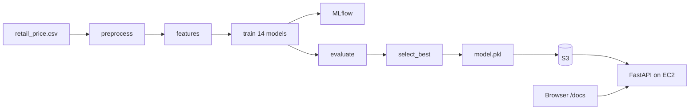

# PriceOptima

## An end-to-end MLOps system for dynamic retail pricing

Laboratory report. The repository is `shreyanshhhhhhhh/MLOps_FinaL`. The demonstration server is an EC2 `t3.micro` in Europe (Stockholm), `eu-north-1`. The model bytes live in the private S3 bucket `priceoptima-sagar-2026`.

The slide deck for the same material is `docs/PriceOptima_Presentation.pptx`.

## Aim

Build a system that predicts how many units a retail product will sell in a month, then chooses a price that maximises profit, and run that system the way a production model is run: versioned data, tracked experiments, one promoted model, a service that uses the same features as training, and a deployment that can roll back.

## Objectives

1. Turn the Kaggle retail-price table into a reproducible pipeline whose settings live in one file.
2. Train several model families, record every run, and promote the run with the lowest test error.
3. Hold out future months, so the test score is not a random mix of the same months the model was fit on.
4. Serve the promoted model over HTTP, and compute a recommended price from the same model.
5. Keep the training code and the serving code on one feature implementation, so the two cannot drift apart.
6. Ship the service in a container that downloads the model at start, instead of baking the pickle into the image.
7. Check every change with lint, tests, a DVC lock check, and an image build.
8. Deploy the container on AWS using the free-tier sizes: one private S3 bucket and one `t3.micro` instance.

These line up with the laboratory outcomes: cloud and MLOps fundamentals, pipeline and CI/CD, tracking and optimisation, and documentation plus deployment.

## Problem

A retailer sets a price before the month begins. The useful prediction is the quantity that price will sell, not a label after the month is over. Once quantity can be predicted at a candidate price, profit at that price is `predicted quantity × (price − unit cost)`. The system scores a grid of prices and keeps the best one.

The dataset is the Kaggle Retail Price Optimization file `retail_price.csv`: 676 product-months, 30 columns, January 2017 through August 2018. Each row is one product in one month. The target column is `qty`.

## Dataset split

The split is not 20% of the rows inside every month. `params.yaml` sets `test_size: 0.2` and `strategy: chronological`. The file has 20 distinct months. The last 20% of those months are the entire test set: May, June, July, and August 2018. Training uses January 2017 through April 2018.

| Part | Months | Rows |
| --- | --- | --- |
| Train | 16 months, Jan 2017–Apr 2018 | 516 |
| Test | 4 months, May 2018–Aug 2018 | 160 |

A month is never cut in half. No future month is used to fit the model. The test RMSE is computed once, on those four months. The live API does not re-score 20% of the data every month.

Outlier fences are Tukey intervals fit on the training months only, then applied to both sides. Rows are clipped, not dropped, so the product-month panel stays complete.

## Workflow



One command, `dvc repro`, runs the five stages. A stage whose inputs did not change is skipped.

| Stage | Program | What it writes |
| --- | --- | --- |
| preprocess | `src/preprocess.py` | `train.csv`, `test.csv`, `preprocess_meta.json` |
| features | `src/features.py` | feature tables and `preprocessor.joblib` |
| train | `src/train.py` | `train_runs.json` and an MLflow run for each model |
| evaluate | `src/evaluate.py` | `metrics.json` and residual plots |
| select_best | `src/select_best.py` | `model.pkl` and `model_meta.json` |

### The three control files

**`params.yaml` is the settings.** Seed 42, the 20% chronological split, the date format `%d-%m-%Y`, the target `qty`, the feature list, and the 14-model grid. Change a value here, then `dvc repro` reruns only the stages that depend on it.

**`dvc.yaml` is the recipe.** It names the command, the input files, the parameters, and the output files for each stage. It does not contain the CSV or the pickle.

**`dvc.lock` is the proof.** After a run, DVC writes the MD5 of the code, of the parameter values, and of every output. CI refuses the branch unless `dvc status` and `dvc repro --dry` both say the pipeline is up to date.

Git stores the code and the lock. DVC stores the CSV and the model by hash. Two machines with the same lock get the same bytes.

## Models

Fourteen runs are logged in the MLflow experiment `priceoptima-demand`. The selection metric is test RMSE. Lower is better.

| Family | Best setting | Test RMSE | Test MAE | Test R² |
| --- | --- | --- | --- | --- |
| Gradient boosting | 100 trees, learning rate 0.05, depth 3 | 7.53 | 5.43 | 0.50 |
| Random forest | 100 trees, depth 16 | 7.76 | 5.66 | 0.47 |
| LightGBM | 100 trees, learning rate 0.1, 31 leaves | 7.83 | 5.59 | 0.46 |
| Ridge | alpha 10 | 10.76 | 9.25 | −0.02 |
| Linear regression | fit intercept | 10.99 | 9.47 | −0.06 |

Two LightGBM settings, 31 leaves and 63 leaves, land on the same test RMSE. The training panel has 516 rows and LightGBM stops splitting before it can use 63 leaves. Both settings stay in the log, because the grid is the experiment record.

For the sample bed product (`bed_bath_table`, May 2018, price 39.99) the recorded sales were 19 units. Gradient boosting predicts about 7.91.

### Two model versions

| Tag | Model | Test RMSE | Role |
| --- | --- | --- | --- |
| `model-v1` | Gradient boosting | 7.53 | Best experiment. Pulled when `MODEL_VERSION=model-v1`. |
| `model-v2` | Ridge, alpha 10 | 10.76 | The lock inside the current image. A worse model, kept so a swap is visible. |

`/optimize-price` scores every price from `min_price` to `max_price`. If `unit_cost` is sent, the score is profit. If it is omitted, the score is revenue. The response includes `best_price`, expected demand, expected profit, and the elasticity around the chosen price.

## Architecture

```mermaid
flowchart TB
  subgraph dev [Laptop and GitHub]
    code[Git: code, dvc.yaml, dvc.lock, params.yaml]
    ci[GitHub Actions: lint, test, lock check, docker build]
  end
  subgraph aws [AWS free tier, eu-north-1]
    s3[(S3 priceoptima-sagar-2026)]
    ec2[EC2 t3.micro]
  end
  code --> ci
  ci --> image[Docker image: code only]
  image --> ec2
  s3 --> ec2
  ec2 --> docs[/docs, /predict-demand, /optimize-price]
```

The image copies `dvc.lock` and the application. It does not copy `model.pkl`. On start, `scripts/entrypoint.sh` launches `scripts/fetch_model.sh` and uvicorn together. `/health` is 200 as soon as the process is up. `/ready` stays 503 until `model.pkl`, `preprocessor.joblib`, and `model_meta.json` have been loaded.

Serving calls `add_engineered_features` and `transform_frame` from `src/features.py`. Those are the same functions the features stage runs. There is no second feature implementation under `app/`.

## CI/CD

`.github/workflows/ci.yml` runs four jobs, in order. A failure stops the rest.

| Job | What it checks |
| --- | --- |
| lint | Ruff on `src`, `app`, and `tests` |
| test | Pytest, with a coverage report uploaded as an artifact |
| pipeline-check | `dvc pull`, then `dvc status` and `dvc repro --dry` must say the lock is up to date |
| build | `docker build`. The image is not pushed from this job |

If `AWS_ROLE_ARN` or `AWS_ACCESS_KEY_ID` is set, the lock check pulls from S3. If neither secret is set, it pulls the committed `dvc-storage/` directory. That is why CI can be green with no AWS account. Adding a wrong key switches the job to S3 and will fail the pull.

`.github/workflows/cd.yml` is the release path. It runs only after CI succeeds on a push to `main` or a `v*` tag. It smoke-tests the container, fails the release on a critical vulnerability, pushes the image, and SSHes to EC2. `scripts/deploy.sh` records the previous image, starts the new one, and waits up to 120 seconds for `/ready`. If that check fails, it starts the previous image. The container is started with `--restart unless-stopped`, so a reboot brings it back.

The demonstration on 29 October 2026 did not wait for that CD workflow. The image was built on the instance and started with `scripts/deploy.sh`. The instance `curl` of `/ready` returned `{"status":"ready"}`.

## Deployment

| Piece | Where it is |
| --- | --- |
| Code and lock | GitHub, branch history now merged to `main` |
| CSV and model hashes | S3 bucket `priceoptima-sagar-2026`, prefix `priceoptima`, region `eu-north-1` |
| Running API | EC2 instance `priceoptima`, type `t3.micro`, Ubuntu, port 8000 |
| Credentials on the server | IAM role `PriceOptimaEc2`, read-only on that prefix. No access key in the image or in `.env.prod` |
| Laptop upload key | IAM user `priceoptima-laptop`, used only for `dvc push`. It is not stored in Git |

The public IPv4 changes if the instance is stopped and started. The page is `http://<public-ip>:8000/docs`. Port 8000 must be open in the security group. Port 22 is for SSH.

Stop the instance when it is not being demonstrated. A stopped `t3.micro` does not accrue compute charges. Do not leave an unused Elastic IP attached.

## API used in the demonstration

| Endpoint | Role |
| --- | --- |
| `GET /health` | Process is up |
| `GET /ready` | Model files are loaded |
| `GET /model-info` | Name, test RMSE, git commit, data hash |
| `POST /predict-demand` | Quantity at a given price |
| `POST /optimize-price` | Best price on a grid |
| `GET /metrics` | Request counter in Prometheus text |
| `GET /docs` | Swagger UI, the screen used in the viva |

## What each MLOps idea means in this repository

| Idea | Where it is |
| --- | --- |
| Single configuration | `params.yaml` |
| Reproducible pipeline | `dvc.yaml` and `dvc.lock` |
| Data versioning | `data/raw/retail_price.csv.dvc` and the S3 remote |
| Experiment tracking | MLflow experiment `priceoptima-demand` |
| Model registry | `model.pkl`, `model_meta.json`, tags `model-v1` and `model-v2` |
| Training/serving consistency | `src/features.py` imported by `app/model_loader.py` |
| Packaging | `Dockerfile`, model not copied |
| Continuous integration | `.github/workflows/ci.yml` |
| Deployment and rollback | `scripts/deploy.sh` on EC2 |
| Monitoring in this lab | `/ready`, `/metrics`, and `scripts/healthcheck.sh` |

Monitoring here is a readiness check and a request counter. It is not a data-drift detector. That limit should be said plainly in the viva.

## How to reproduce

On a laptop, from a clone of `main`:

```bash
python -m venv .venv
source .venv/bin/activate
pip install -r requirements.txt
dvc pull
dvc dag
pytest
```

The API without Docker:

```bash
pip install -r requirements-serve.txt
dvc pull
python -m uvicorn app.main:app --host 127.0.0.1 --port 8000
```

Open `http://127.0.0.1:8000/docs`.

## Conclusion

PriceOptima is a small pricing service with the MLOps path made visible. The pipeline is deterministic given `params.yaml` and the lock. The experiment record names the winner and also keeps a second model so a rollback changes the prediction. The image and the model are versioned separately. The running copy on EC2 pulls the model from S3 with a read-only role, and `/ready` is the gate that says the model is actually loaded.
